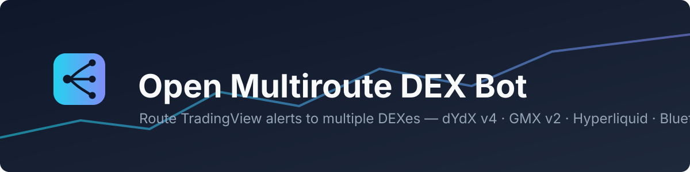
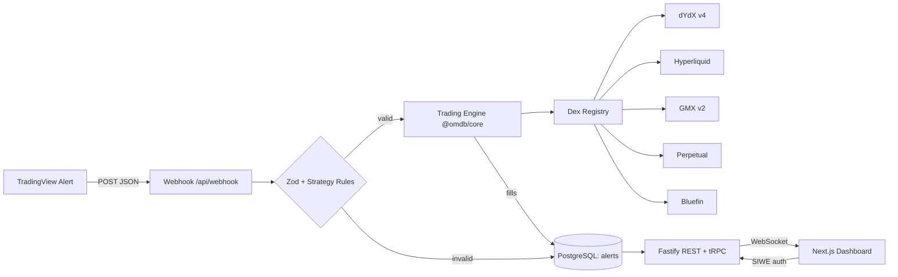
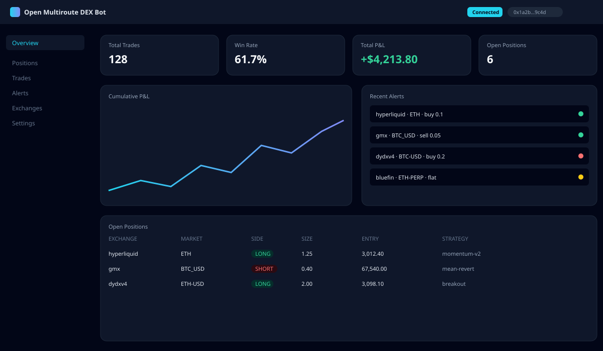

<div align="center">



# Open Multiroute DEX Bot

**A comprehensive open-source trading bot that routes TradingView alerts to multiple DEXes with a modern dashboard.**

[](CHANGELOG.md)
[](LICENSE)
[](.github/workflows/ci.yml)
[](https://www.typescriptlang.org/)
[](packages/core)

[Quick Start](#-quick-start) · [Supported DEXes](#-supported-dexes) · [Architecture](#%EF%B8%8F-architecture) · [Dashboard](#%EF%B8%8F-dashboard) · [Docs](docs/)

</div>

---

## ✨ Features

- 🔀 **Multiroute engine** — one webhook, five DEXes: route each alert to the exchange of your choice
- ⚡ **TradingView-native** — plain JSON alerts, passphrase protection, `reverse` position sizing preserved from the upstream project
- 📊 **Modern dashboard** — Next.js 15 + React 19 with KPIs, P&L charts, positions, alert log and exchange management
- 🔐 **SIWE authentication** — sign in with your Ethereum wallet, no passwords
- 🛡️ **Credentials at rest encrypted** — AES-256-GCM, keys never leave the server
- 🔄 **Realtime** — WebSocket push for trades, alerts and positions
- 🧪 **Type-safe end-to-end** — strict TypeScript, Zod validation, tRPC + OpenAPI
- 📈 **Built-in charting** — Vela Charts embedded in the dashboard; script alerts
  and price levels route straight to the engine, and a Gains demo/test panel
  verifies order placement before going live
- 🐳 **One-command deploy** — docker compose up and you're running
- 🧱 **Monorepo** — Turborepo with shared `@omdb/core` engine and `@omdb/ui` components

## 🎯 Supported DEXes

| Exchange            | Network(s)      | Alert `exchange` value | Status |
| ------------------- | --------------- | ---------------------- | ------ |
| dYdX v4             | mainnet / testnet | `dydxv4` or `dydx`   | ✅     |
| Hyperliquid         | mainnet / testnet | `hyperliquid`        | ✅     |
| GMX v2              | Arbitrum        | `gmx`                  | ✅     |
| Perpetual Protocol  | Optimism        | `perpetual`            | ✅     |
| Bluefin             | Sui mainnet     | `bluefin`              | ✅     |
| Gains Network       | Arbitrum (+ testnet demo) | `gains`     | ✅     |

## 🏗️ Architecture



```
open-multiroute-dex-bot/
├── apps/
│   ├── api/          # Fastify + Prisma + tRPC + Swagger (REST API server)
│   └── web/          # Next.js 15 + React 19 dashboard
├── packages/
│   ├── core/         # Trading engine, DEX clients, shared types
│   └── ui/           # Shared presentational components
├── docker/           # Multi-stage Dockerfiles
├── docs/             # Guides & API reference
└── assets/           # Logo, banner, mockups
```

## 🖥️ Dashboard



Dark-first, mobile-first trading dashboard: KPI cards, cumulative P&L chart,
positions/trades/alerts tables, exchange credential management and wallet
sign-in (RainbowKit + SIWE).

## 🚀 Quick Start

### Docker (recommended)

```bash
git clone https://github.com/algomanlife/open-multiroute-dex-bot.git
cd open-multiroute-dex-bot
cp .env.example .env          # fill in credentials + passphrase
docker compose up -d          # postgres + api + web
# → Dashboard: http://localhost:3001
# → API docs:  http://localhost:3000/docs
```

### Manual (pnpm ≥ 9, Node ≥ 20)

```bash
pnpm install
cp .env.example .env

# start postgres (or point DATABASE_URL at your own)
docker run -d --name omdb-pg -e POSTGRES_USER=omdb -e POSTGRES_PASSWORD=omdb \
  -e POSTGRES_DB=omdb -p 5432:5432 postgres:16

pnpm db:migrate               # prisma migrate deploy
pnpm --filter @omdb/api dev   # API on :3000
pnpm --filter @omdb/web dev   # Dashboard on :3001
```

### Point TradingView at it

1. Create a TradingView alert with **Webhook URL** = `https://your-host/api/webhook`
2. Message body (JSON):

```json
{
  "exchange": "hyperliquid",
  "strategy": "my-strategy",
  "market": "ETH",
  "order": "buy",
  "price": "{{close}}",
  "position": "long",
  "reverse": false,
  "size": 0.1,
  "passphrase": "your-webhook-passphrase"
}
```

## ⚙️ Configuration

All configuration is environment-based (12-factor). See [.env.example](.env.example) for the full annotated list:

| Variable                      | Purpose                                        |
| ----------------------------- | ---------------------------------------------- |
| `DATABASE_URL`                | PostgreSQL connection string                   |
| `WEBHOOK_PASSPHRASE`          | Shared secret required in every alert          |
| `CREDENTIALS_ENCRYPTION_KEY`  | 32-byte hex key encrypting stored API keys     |
| `CORS_ORIGINS`                | Comma-separated allowed dashboard origins      |
| `HYPERLIQUID_PRIVATE_KEY` …   | Per-DEX credentials (only the ones you use)    |

Full API reference: **Swagger UI at `/docs`** once the API is running.

## 🤝 Contributing

See [CONTRIBUTING.md](CONTRIBUTING.md). Security reports: [SECURITY.md](SECURITY.md).
Changelog: [CHANGELOG.md](CHANGELOG.md). Migrating from the upstream project:
[docs/MIGRATION.md](docs/MIGRATION.md).

## ⚖️ License & Credits

Released under the [MIT License](LICENSE).

This project is a modernized rebuild of
[tradingview-alert-connector](https://github.com/junta/tradingview-alert-connector)
(by 0xIbuki, GPL-3.0). The DEX client routing logic was ported and heavily
refactored — see [NOTICE.md](NOTICE.md) for attribution details. Use at your
own risk: trading perpetuals is high-risk and this software comes with no
warranty.
